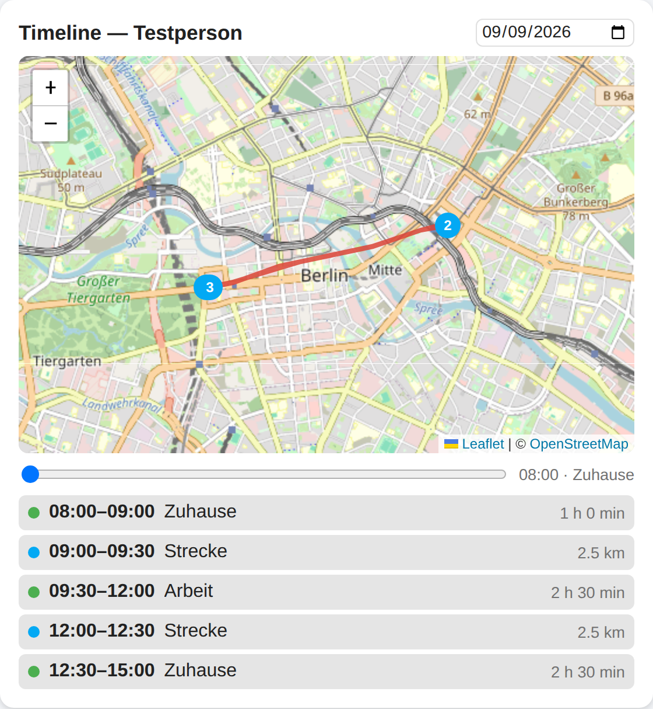

# Local Track Cards

**Zwei Lovelace-Karten zu Local Track: der Tagesweg einer Person auf der
Landkarte und die Verweildauer an einem Ort, Monat für Monat.**



| Karte | Wofür |
| --- | --- |
| `localtrack-timeline-card` | Tagesweg einer `person.*`- oder `device_tracker.*`-Entität auf der Landkarte, mit Aufenthalten, Strecken und Zeitregler |
| `localtrack-zone-time-card` | wie lange eine Person an einem Ort (Zone) war, ein Monat als Tagesliste mit Netto- und Bruttozeit |

Beide Karten lassen sich über *Karte hinzufügen* mit Vorschau und grafischem
Editor einrichten, ohne YAML. Sie sprechen Deutsch und Englisch nach der
Spracheinstellung von Home Assistant.

## Voraussetzungen

- Home Assistant **2026.9.3** oder neuer
- Die Integration
  [**Local Track**](https://github.com/luukkii123/ha-localtrack-integrations),
  eingerichtet unter Einstellungen → Geräte & Dienste. Sie liefert die
  WebSocket-Kommandos, über die die Karten ausschließlich lesen. Die
  Verweildauer-Karte braucht Local Track **ab Version 0.3.0**.

Ist die Integration nicht eingerichtet, zeigt die Karte einen Hinweis mit dem
Weg dorthin.

## Installation

Über HACS:

1. HACS → ⋮ → **Benutzerdefinierte Repositories** (Custom repositories)
2. Repository `https://github.com/luukkii123/ha-localtrack-cards`, Kategorie
   **Dashboard**
3. **Local Track Cards** herunterladen und die Seite hart neu laden (Strg+F5),
   sonst bleibt die alte Datei im Cache
4. Karte hinzufügen: Sie erscheint in der Kartenauswahl als **Local Track
   Timeline** bzw. **Local Track Verweildauer**

Manuell: `dist/localtrack-cards.js` nach `<config>/www/localtrack-cards.js`
kopieren und unter Einstellungen → Dashboards → ⋮ → **Ressourcen** eintragen:
URL `/local/localtrack-cards.js`, Typ **JavaScript-Modul**.

## Timeline-Karte

Zeigt den Weg eines Tages auf einer Landkarte (Leaflet, in der Datei
enthalten). Aufenthalte erscheinen als nummerierte Nadeln, Start grün und Ende
rot. Unter der Karte stehen ein Zeitregler und die Liste aller Aufenthalte und
Strecken mit Zeitspanne und Dauer bzw. Länge. Ein Klick oder Enter/Leertaste auf
eine Zeile zentriert die Karte darauf. Aufenthalte werden zuerst gegen die Zonen
von Home Assistant benannt; passt keine, heißen sie „Aufenthalt".

```yaml
type: custom:localtrack-timeline-card
entity: person.beispiel
```

| Schlüssel | Typ | Vorgabe | Bedeutung |
| --- | --- | --- | --- |
| `entity` | Entitäts-ID | — (Pflicht) | `person.*` oder `device_tracker.*` |
| `title` | Text | Name der Person | Überschrift; ohne Angabe der `friendly_name`, sonst die Entitäts-ID |
| `height` | Zahl (px) | `320` | Höhe der Landkarte (Editor: 240–720) |
| `stay_radius_m` | Zahl (m) | `150` | Punkte innerhalb dieses Abstands vom laufenden Mittelpunkt gelten als derselbe Ort (Editor: 10–1000) |
| `min_stay_minutes` | Zahl (min) | `10` | Mindestdauer, ab der ein Halt als Aufenthalt zählt; kürzere gehören zur Strecke (Editor: 1–240) |
| `show_scrubber` | Ja/Nein | `true` | Zeitregler unter der Karte anzeigen |
| `reverse_geocode` | Ja/Nein | `false` | Aufenthalte ohne passende Zone über OpenStreetMap (Nominatim) benennen |
| `max_points` | Zahl | `2000` | Höchstzahl der Punkte je Tag (Editor: 100–5000) |
| `tile_url` | Text | leer | leer: OpenStreetMap; sonst eine eigene Kachel-URL im Leaflet-Format |

Bedienung: Das **Datum** oben rechts wählt den Tag (Vorgabe heute). Der
**Zeitregler** fährt die Route ab und zeigt Uhrzeit und Zone (oder
„unterwegs"). Bei heutigem Datum lädt die Karte nach einer Positionsänderung
nach einigen Sekunden nach.

## Verweildauer-Karte

Beantwortet „wie lange war ich diesen Monat bei der Arbeit". Person und Ort sind
Ausklappmenüs, der Monat wird mit den Pfeilschaltflächen geblättert. Die Karte zeigt je Tag
die Netto- und (optional) die Bruttozeit mit einem Balken sowie Summe und
Tagesschnitt.

```yaml
type: custom:localtrack-zone-time-card
entity: person.beispiel
zone: zone.arbeit
```

| Schlüssel | Typ | Vorgabe | Bedeutung |
| --- | --- | --- | --- |
| `entity` | Entitäts-ID | — (Pflicht) | `person.*` oder `device_tracker.*`; Anfangsauswahl, im Menü umschaltbar |
| `zone` | Entitäts-ID | — (Pflicht) | eine `zone.*` mit Mittelpunkt und Radius; Anfangsauswahl, im Menü umschaltbar |
| `title` | Text | Name der Zone | Überschrift der Karte |
| `min_visit_minutes` | Zahl (min) | `5` | Kürzere Aufenthalte zählen gar nicht (Editor: 0–360) |
| `max_gap_minutes` | Zahl (min) | `30` | So viel wird von einer Datenlücke höchstens gutgeschrieben; längere Lücken beenden den Aufenthalt (Editor: 1–1440) |
| `show_gross` | Ja/Nein | `true` | Bruttospalte anzeigen |

**Netto** ist die Summe der Zeit tatsächlich am Ort, **brutto** die Spanne von
der ersten Ankunft bis zur letzten Abfahrt desselben Tages. Die Differenz ist die
Zeit außerhalb, etwa eine Mittagspause oder ein Datenloch. Ist das Handy lange
aus, schreibt netto nur `max_gap_minutes` gut, statt Zeit zu erfinden. Zerfällt
ein Tag in viele Aufenthalte, ist `max_gap_minutes` zu niedrig; für Sitztage sind
60 Minuten vertretbar. Die Menüs füllen sich aus den Personen, die Local Track
gerade aufzeichnet, und aus den Zonen von Home Assistant mit Mittelpunkt und
Radius.

## Design und Themes

Die Karten definieren keine eigenen Theme-Variablen. Sie rendern in `ha-card` und
übernehmen die Variablen des aktiven Home-Assistant-Themes, vor allem
`--primary-color`, `--primary-text-color`, `--secondary-text-color`,
`--secondary-background-color`, `--card-background-color`, `--divider-color`,
`--success-color`, `--error-color`, `--ha-card-border-radius` sowie die
Abstands- und Schriftvariablen `--ha-space-*` und `--ha-font-*`. Hell und Dunkel
folgen dem Theme.

## Datenschutz und Grenzen

- Die Karten lesen nur über die Integration Local Track; die Standortdaten
  bleiben in Home Assistant.
- **Kartenkacheln** kommen von openstreetmap.org, solange `tile_url` leer ist.
  Dabei sieht der Kachelserver, welcher Kartenausschnitt abgerufen wird. Wer das
  nicht will, trägt einen eigenen Kachelserver ein.
- **`reverse_geocode: true` schickt Koordinaten an einen Dritten**
  (nominatim.openstreetmap.org). Standardmäßig ist das aus; die Zuordnung zu
  Zonen von Home Assistant bleibt lokal.
- Die Routenqualität hängt an der Datenquelle: Die Companion-App meldet im
  Standardmodus nur bei deutlicher Bewegung oder Zonenwechsel, die Linien sind
  dann gerade. „Hohe Genauigkeit" in der App liefert dichtere Spuren.
- Die Timeline zeigt einen Tag und eine Person; es gibt keine Wochenansicht und
  keinen Vergleich.
- Die Verweildauer-Karte zeigt einen Ort je Karte (für zwei Orte zwei Karten),
  keine Besuchsliste je Tag und keinen Sollzeit-Vergleich.
- Zwei Aufenthalte am selben Ort stapeln ihre Nadeln; die Liste zeigt beide.

## Entwicklung

Auslieferung, Tests und Hintergründe: [docs/entwicklung.md](docs/entwicklung.md).

## Lizenz

MIT, siehe [LICENSE](LICENSE). Das eingebettete Leaflet 1.9.4 steht unter
BSD-2-Clause, © 2010–2023 Vladimir Agafonkin, © 2010–2011 CloudMade.
